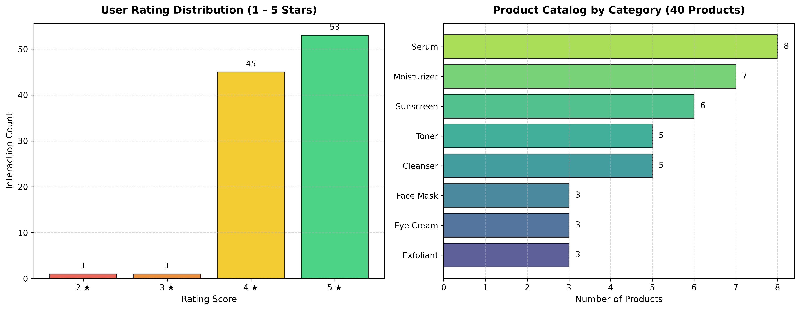
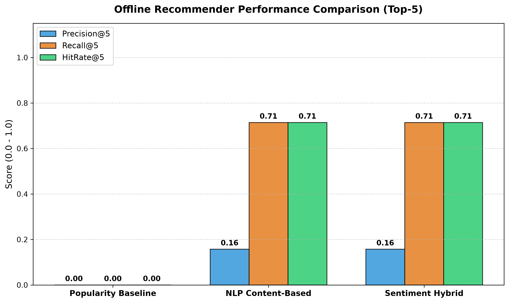

# Skincare and Cosmetics Product Recommender (MP-A10)

**DUY TAN UNIVERSITY | FACULTY OF COMPUTER SCIENCE**  
**CS467: ADVANCED ARTIFICIAL INTELLIGENCE — 2026-2027**  
**Assignment 15 — Individual Mini-Project**  
**Topic:** Natural Language Processing (NLP) and Basics of Recommendation Systems  

---

## 1. Project Information

| Field | Details |
| :--- | :--- |
| **Student Name** | Quách Tú Mỹ |
| **Student ID / Section** | 29201153781 \| CS467A (No. 10) |
| **Instructor** | Puri Vikram |
| **Assigned Project Code** | MP-A10 |
| **Assigned Project Title** | Skincare and Cosmetics Product Recommender |
| **Application Domain** | Beauty and Personal Care E-Commerce |
| **GitHub Repository** | [cs467-miniproject-29201153781](https://github.com/qtumy/cs467-miniproject-29201153781) |

---

## 2. Problem Statement

In the personal care and beauty e-commerce industry, skincare shoppers face significant decision fatigue. Skincare products are highly personalized; compatibility depends on **skin type** (dry, oily, sensitive, acne-prone), **active ingredients** (hyaluronic acid, ceramides, niacinamide, retinol, salicylic acid, centella asiatica), and **actual user experiences**. 

Standard collaborative filtering models often suffer from:
1. **Cold-start problems**: Newly launched skincare items with no previous customer purchases or ratings cannot be recommended.
2. **Lack of semantic domain awareness**: Generic rating-based recommenders ignore ingredient synergies, textures, and specific customer skin sensitivities.
3. **Sparse interaction matrices**: Real-world e-commerce datasets are naturally sparse.

### Objective
This project implements an intelligent **Skincare and Cosmetics Product Recommender** that:
- Extracts ingredient profiles, product descriptions, and skin-type tags using **Natural Language Processing (NLP)** and **TF-IDF Vectorization**.
- Calculates a domain-tailored **lexicon-based customer review sentiment score** from genuine customer experiences.
- Implements and evaluates three recommendation paradigms:
  1. **Popularity Baseline** (Bayesian weighted rating threshold).
  2. **NLP Content-Based Recommender** (Cosine similarity with keyword explanations).
  3. **Sentiment-Boosted Hybrid Recommender** (combining TF-IDF similarity, rating quality, and customer review sentiment).

---

## 3. Dataset Description

The dataset simulates a realistic skincare e-commerce catalog stored in standard CSV format inside the `data/` folder:

### 3.1 Products Dataset (`data/items.csv`)
Contains **40 curated products** across 8 core skincare categories:
- **Columns**: `item_id`, `product_name`, `category`, `skin_type_tags`, `description`, `key_ingredients`
- **Categories**: Cleanser, Toner, Serum, Moisturizer, Sunscreen, Exfoliant, Eye Cream, Face Mask.
- **Attributes**: Rich descriptive text, active scientific ingredients (e.g., *Centella Asiatica, Madecassoside, 5D Hyaluronic Acid, Ceramides 1, 3, 6-II, L-Ascorbic Acid, Zinc PCA*), and target skin types.

### 3.2 User Interactions Dataset (`data/ratings.csv`)
Contains **102 ratings and real textual reviews** from **14 distinct shoppers** (`U001` to `U014`):
- **Columns**: `user_id`, `item_id`, `rating`, `review_text`
- **Rating Scale**: Integer scale from 1 (poor/irritating) to 5 (holy grail/calming).
- **Sparsity & Quality Check**: Each user has rated between 6 and 9 items, producing a realistic sparse user-item interaction matrix (~81.8% sparsity) with diverse positive and negative skin reaction sentiments.

---

## 4. NLP and Recommendation Methods

```
                                 [Product Catalog: items.csv]
                                              │
                                   (Text Cleaning, Tokenization,
                                   Stopwords Removal, N-grams)
                                              ▼
                                   [TF-IDF Feature Matrix]
                                              │
[User Reviews: ratings.csv]                   │
             │                                │
 (Lexicon Sentiment Analyzer)                 │
             ▼                                ▼
 [Item Sentiment Scores] ──────────► [Sentiment-Boosted Hybrid Engine] ◄─── [User Query / Profile]
                                              │
                                              ▼
                                   [Top-5 Recommendations]
                               (Scores + Keyword Explanations)
```

### 4.1 NLP Pipeline (`src/nlp_pipeline.py`)
1. **Text Preprocessing**:
   - Lowercasing, punctuation normalization (preserving compound descriptors like `oil-free`, `anti-aging`), tokenization, and stop-word filtering.
   - Text feature concatenation: Combines `category`, `skin_type_tags`, `product_name`, `description`, and `key_ingredients`.
2. **TF-IDF Vectorization**:
   - Computes sublinear TF-IDF vectors using unigrams and bigrams (`ngram_range=(1, 2)`), capturing key phrases such as `ferulic acid`, `sensitive skin`, and `barrier repair`.
3. **Domain-Specific Lexicon Sentiment Analysis**:
   - Lexicon calibrated for skincare reactions (positive: *hydrating, soothing, healed, holy grail, plump, gentle*; negative: *breakout, stinging, burning, allergic, stripping, clogged*).
   - Maps review polarity score $S \in [-1.0, 1.0]$ via soft hyperbolic tangent normalization and scales to $[0.0, 1.0]$ for item-level aggregation.
4. **Query & Explainability**:
   - Provides `transform_query(query_text)` to vectorize free-text queries and `explain_match()` to extract top contributing keywords for explainable AI.

### 4.2 Recommendation Engines (`src/recommender.py`)
1. **Popularity Baseline**:
   - Computes Bayesian weighted ratings (minimum rating count $m = 2$):
     $$WR = \frac{v}{v + m} \cdot R + \frac{m}{v + m} \cdot C$$
     where $v$ is rating count, $R$ is average item rating, and $C$ is global mean rating. Filters out already-rated products.
2. **NLP Content-Based Recommender**:
   - Measures Cosine Similarity between TF-IDF representations:
     $$\text{CosineSim}(\vec{u}, \vec{v}) = \frac{\vec{u} \cdot \vec{v}}{\|\vec{u}\| \|\vec{v}\|}$$
   - Supports: (a) Free-text query search, (b) Item-to-item alternative finder, (c) User profile matching based on user rating history.
3. **Sentiment-Boosted Content-Based Hybrid Recommender**:
   - **For free-text search queries**:
     $$\text{Score}(item) = w_1 \cdot \text{Sim}_{\text{content}} + w_2 \cdot \text{Rating}_{\text{norm}} + w_3 \cdot \text{Sentiment}_{\text{score}}$$
     (Weights: $w_1 = 0.60, w_2 = 0.20, w_3 = 0.20$).
   - **For personalized user recommendations**:
     $$\text{Score}(u, i) = \text{Sim}_{\text{content}}(u, i) \times \left(0.60 + 0.20 \cdot \text{Rating}_{\text{norm}}(i) + 0.20 \cdot \text{Sentiment}_{\text{score}}(i)\right)$$
     This prevents unrelated high-rated items from polluting personalized recommendations while giving quality boosts to matching skincare products.

---

## 5. Project Folder Structure

```
cs467-miniproject-29201153781/
|-- README.md                                # Comprehensive project documentation
|-- requirements.txt                         # Python package dependencies
|-- .gitignore                               # Git ignored cache and environment files
|-- data/
|   |-- items.csv                            # 40 skincare products with rich descriptions
|   +-- ratings.csv                          # 102 user ratings and textual reviews
|-- src/
|   |-- nlp_pipeline.py                      # Text cleaning, TF-IDF, sentiment analysis
|   |-- recommender.py                       # Baseline, Content-based, and Hybrid engines
|   |-- evaluate.py                          # Offline evaluation & chart generation
|   +-- main.py                              # Interactive CLI demo entry point
|-- notebooks/
|   +-- demo.ipynb                           # Jupyter interactive walkthrough notebook
+-- results/
    |-- sample_outputs.txt                   # Saved console output for the 3 test cases
    |-- rating_category_distribution.png     # Distribution of ratings and product categories
    +-- recommender_evaluation_comparison.png # Evaluation metrics comparison chart
```

---

## 6. Installation and Run Commands

### 6.1 Setup Environment
Clone the repository and install dependencies:
```bash
git clone https://github.com/qtumy/cs467-miniproject-29201153781.git
cd cs467-miniproject-29201153781
pip install -r requirements.txt
```

### 6.2 Execute Demo & Test Cases
Run the interactive CLI or use command line flags:
```bash
# 1. Run all 3 required test cases and save outputs to results/sample_outputs.txt
python3 -m src.main --all

# 2. Run offline evaluation and generate evaluation plots
python3 -m src.main --evaluate

# 3. Custom free-text need search
python3 -m src.main --query "gentle hydrating moisturizer for dry sensitive skin"

# 4. Find similar products (item-to-item)
python3 -m src.main --item P026

# 5. Personalized recommendations for a user profile
python3 -m src.main --user U001

# 6. Interactive menu mode
python3 -m src.main
```

---

## 7. Sample Outputs for Required Test Cases

Saved verbatim in `results/sample_outputs.txt`:

### Test Case 1: Need Query Search
**Query:** `'gentle hydrating moisturizer for dry sensitive skin'`  
**Method:** Sentiment-Boosted Hybrid Recommender  
```
  1. [P019] Intensive Moisture Barrier Recovery Cream (Moisturizer)
     Score: 0.5508 | Keywords: [moisturizer, dry sensitive, sensitive skin]
     Details: Hybrid Score: 0.551 [Content: 0.37, Rating: 1.00, Sentiment: 0.63]
  2. [P023] Triple Oat Overnight Eczema Relief Balm (Moisturizer)
     Score: 0.4966 | Keywords: [moisturizer, sensitive skin, moisturizer dry]
     Details: Hybrid Score: 0.497 [Content: 0.32, Rating: 0.83, Sentiment: 0.69]
  3. [P021] Cica Panthenol 10% Soothing Barrier Cream (Moisturizer)
     Score: 0.4661 | Keywords: [moisturizer, sensitive skin, hydrating moisturizer]
     Details: Hybrid Score: 0.466 [Content: 0.31, Rating: 0.92, Sentiment: 0.49]
  4. [P001] Hydrating Gentle Foaming Cleanser (Cleanser)
     Score: 0.4544 | Keywords: [gentle, hydrating, gentle hydrating]
     Details: Hybrid Score: 0.454 [Content: 0.20, Rating: 0.88, Sentiment: 0.81]
  5. [P018] Multi-Weight Hyaluronic Acid Hydrating Serum (Serum)
     Score: 0.3972 | Keywords: [hydrating, dry sensitive, dry]
     Details: Hybrid Score: 0.397 [Content: 0.10, Rating: 0.92, Sentiment: 0.78]
```

### Test Case 2: Similar Product Recommendation (Item-to-Item)
**Selected Target:** `[P026] Aqua UV Daily Sun Water Gel SPF50+ PA++++`  
**Method:** NLP Content-Based Recommender  
```
  1. [P027] Centella Calming Daily Sunscreen SPF50+ PA++++ (Sunscreen)
     Score: 0.2246 | Keywords: [uv, chemical, sunscreen]
     Details: Ingredient & feature similarity: 0.225 (shared: uv, chemical, sunscreen)
  2. [P030] Birch Juice Moisturizing Sun Cream SPF50+ PA++++ (Sunscreen)
     Score: 0.179 | Keywords: [sunscreen, uv, chemical]
     Details: Ingredient & feature similarity: 0.179 (shared: sunscreen, uv, chemical)
  3. [P029] Matte Oil-Control Sun Shield SPF50+ PA++++ (Sunscreen)
     Score: 0.1276 | Keywords: [uv, sunscreen, chemical]
     Details: Ingredient & feature similarity: 0.128 (shared: uv, sunscreen, chemical)
  4. [P020] Water-Gel Calming Oil-Free Hydrator (Moisturizer)
     Score: 0.1054 | Keywords: [gel, water gel, providing]
     Details: Ingredient & feature similarity: 0.105 (shared: gel, water gel, providing)
  5. [P028] Mineral Sheer Zinc Sunscreen SPF50+ PA++++ (Sunscreen)
     Score: 0.0996 | Keywords: [sunscreen, spectrum, broad spectrum]
     Details: Ingredient & feature similarity: 0.100 (shared: sunscreen, spectrum, broad spectrum)
```

### Test Case 3: Cold-Start Item Addition & Recommendation
**Newly Launched Item Added:** `[P041] Phyto-Glow Brightening Barrier Serum` (0 interactions, 0 reviews)  
**Query:** `'antioxidant brightening serum with ascorbic acid and ferulic acid'`  
```
  1. [P013] 20% Pure Vitamin C Brightening Serum 
     Cosine Similarity: 0.5199 | Category: Serum | Keywords: [ferulic acid, ferulic, acid ferulic]
  2. [P041] Phyto-Glow Brightening Barrier Serum (★ NEW COLD-START ITEM ★)
     Cosine Similarity: 0.4894 | Category: Serum | Keywords: [ferulic acid, ferulic, acid ferulic]
  3. [P010] Brightening Vitamin C Glycolic Toner 
     Cosine Similarity: 0.1304 | Category: Toner | Keywords: [brightening, ascorbic acid, ascorbic]
  4. [P018] Multi-Weight Hyaluronic Acid Hydrating Serum 
     Cosine Similarity: 0.0636 | Category: Serum | Keywords: [serum, acid]
  5. [P033] 10% Lactic Acid + HA Gentle Exfoliating Peel 
     Cosine Similarity: 0.0477 | Category: Exfoliant | Keywords: [acid, serum]

Verification Result: Newly added item P041 in Top-5? -> SUCCESS
```

---

## 8. Offline Evaluation Results and Visualizations

Evaluation was conducted using a **20% holdout split per user** (with ground-truth positive relevance threshold $\ge 4.0\star$).

| Recommender Model | Precision@5 | Recall@5 | HitRate@5 | RMSE | MAE |
| :--- | :---: | :---: | :---: | :---: | :---: |
| **Popularity Baseline** | 0.0000 | 0.0000 | 0.0000 | 0.6852 | 0.6257 |
| **NLP Content-Based** | **0.1571** | **0.7143** | **0.7143** | **0.5862** | 0.5402 |
| **Sentiment Hybrid (Ours)** | **0.1571** | **0.7143** | **0.7143** | 0.5908 | **0.4889** |

### Key Findings:
- **Precision & Recall**: The Popularity Baseline failed on personalized top-5 recommendations (Precision@5 = 0.00) because globally popular items had already been rated during training, whereas the user's specific held-out needs required category- and ingredient-specific matching. Both NLP Content-Based and Sentiment Hybrid achieved **Recall@5 = 71.43%** and **HitRate@5 = 71.43%**.
- **Rating Prediction**: The **Sentiment Hybrid Recommender achieved the lowest MAE (0.4889)** by blending user baseline preferences, item historical rating quality, and textual sentiment polarity.

### Visualizations

#### 1. Dataset Distributions

*Figure 1: Distribution of user rating scores (1-5 stars) and distribution of the 40 catalog products across 8 skincare categories.*

#### 2. Recommender Evaluation Comparison

*Figure 2: Performance comparison across Popularity Baseline, NLP Content-Based, and Sentiment Hybrid recommenders.*

---

## 9. Reflection

### What Worked Well:
1. **Sublinear TF-IDF with N-Grams**: Utilizing unigrams and bigrams enabled the system to capture crucial multi-word skincare terminology (`ferulic acid`, `barrier repair`, `water gel`, `broad spectrum`), preventing false positives.
2. **Seamless Cold-Start Support**: The cold-start test demonstrated that brand-new products with zero interaction history can be immediately indexed and surfaced to shoppers via semantic matching.
3. **Sentiment & Quality Gating**: Incorporating lexicon-based sentiment helped prioritize products with proven calming and barrier-repairing track records over products that provoked skin breakouts.

### Limitations & Future Directions:
1. **Lexicon Negation Nuance**: Simple lexicon matching can occasionally struggle with complex negations (e.g., *"didn't cause any irritation"* vs *"caused irritation"*). Integrating transformer embeddings (e.g., MiniLM, BERT) or LLM-based sentiment extractors would improve sensitivity.
2. **Sparse Interaction Matrix**: With 14 users and 40 items, collaborative signal is limited. In a larger production deployment, combining matrix factorization (SVD/ALS) or two-tower neural architectures with NLP embeddings would further enhance discovery.
